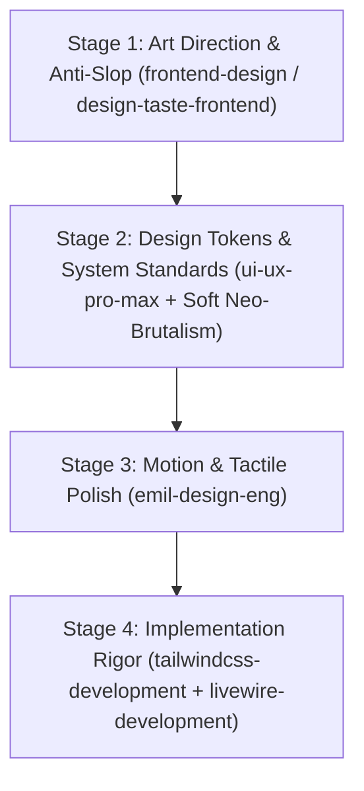

# HUNI UI/UX Skill Stack & Design Governance

> **Project:** HUNI (`c:\Herd\huniapp`)  
> **Status:** Active & Enforced  
> **Target Aesthetic:** Soft Neo-Brutalism  
> **Primary Goal:** Eliminate generic AI-generated templates and maintain a tactile, high-craft product experience.

---

## 1. Executive Summary

HUNI is an all-in-one boarding house (kost) management platform serving property owners and tenants. To prevent the interface from degrading into generic, AI-generated SaaS defaults (centered gradient heroes, identical rounded cards with soft blurry shadows, low-contrast text, and template chrome), HUNI maintains a dedicated **UI/UX Skill Stack** installed directly inside `.agents/skills/`.

This document formalizes the installed skill stack, activation triggers, priority hierarchy, conflict resolution rules, and the integration with HUNI's signature **Soft Neo-Brutalism** design system.

---

## 2. Installed UI/UX Skill Stack Inventory

The project-level skill stack consists of 4 specialized UI/UX skills alongside HUNI's core framework skills:

| Skill Identifier | Source Repository | Core Focus | Location |
| :--- | :--- | :--- | :--- |
| **`frontend-design`** | `anthropics/skills` | Art direction, intentionality, bespoke typography & anti-slop guidelines | `.agents/skills/frontend-design/` |
| **`emil-design-eng`** | `emilkowalski/skills` | Design engineering, spring animations, micro-interactions, tactile polish | `.agents/skills/emil-design-eng/` |
| **`ui-ux-pro-max`** | `nextlevelbuilder/ui-ux-pro-max-skill` | Design intelligence, tokens, searchable styles, component guidelines | `.agents/skills/ui-ux-pro-max/` |
| **`design-taste-frontend`** | `Leonxlnx/taste-skill` | Anti-slop frontend rules, visual density, variance dials, browser critique | `.agents/skills/design-taste-frontend/` |

### Complementary Framework Skills (Pre-installed)
- **`tailwindcss-development`**: Enforces Tailwind CSS best practices, utility hygiene, and responsive layout structures.
- **`livewire-development`**: Reactive state management, form validation, and event handling without client-side framework overhead.
- **`laravel-best-practices`**: Backend security, controller thinness, query optimization, and authorization policies.

---

## 3. Deep Dive into the 4 UI/UX Skills

### 3.1. `frontend-design` (Anthropic Design Lead Model)
- **Philosophy:** Treat every screen like a design lead at a specialized studio. Explicitly reject proposals that feel cliché or templated.
- **Anti-Slop Calibration:** Explicitly detects and prohibits AI-generated design tells:
  - Defaulting to a warm-clay accent `#D97757` or purple gradient washes.
  - Using all-caps eyebrow labels (`TRACKED-OUT ALL CAPS`) above every heading.
  - Joining meta strings with middle dots indiscriminately (`A · B · C`).
  - Chopping all content into identical cards with uniform soft shadows (`rgba(0,0,0,0.1)`).
- **Core Process:** Two-pass methodology:
  1. *Design Plan:* Define 4–6 hex values, typography roles, and ASCII layout wireframes with deliberate asymmetry.
  2. *Self-Critique:* Contrast against generic templates before writing code. Spend boldness in one memorable place.

### 3.2. `emil-design-eng` (Emil Kowalski Design Engineering)
- **Philosophy:** Software is good enough everywhere; craft and taste are the differentiators. Taste is a trained instinct that compounds small details into something that feels physically right.
- **Micro-Interaction Rules:**
  - **Easing:** Never use `ease-in` for entering elements or symmetric ease for interactive responses. Use custom springs or snappy `cubic-bezier(0.16, 1, 0.3, 1)` easing.
  - **Durations:** Snappy durations (150ms–220ms for micro-actions, 280ms–350ms for larger surfaces).
  - **Transform Origins:** Always anchor scaling/popover animations to their trigger point (e.g., origin top-left or trigger center).
  - **Active State Feedback:** Buttons and interactive cards must provide instant tactile feedback on `:active` (`translate-x-[2px] translate-y-[2px] shadow-none`).

### 3.3. `ui-ux-pro-max` (Design Intelligence & Local Knowledge Base)
- **Philosophy:** Systematic design tokens grounded in data-driven reasoning rather than arbitrary intuition.
- **Embedded Capabilities:**
  - Local dataset with 79 curated UI styles (Neo-Brutalism, Modern Minimalist, Bento Grid, High-Density Analytics).
  - 192 product color palettes with domain-specific color reasoning profiles.
  - 74 typography pairings with optical scale guidance.
  - Stack-specific implementation rules for `laravel.csv` and `html-tailwind.csv`.
- **Usage in HUNI:** Reference when establishing token consistency, selecting color harmonies for badges/alerts, and structuring complex dashboard bento grids.

### 3.4. `design-taste-frontend` (Taste Skill v2 / Anti-Slop Inspector)
- **Philosophy:** Art direction for websites and applications distilled from an empirical study of 247 award-winning websites (Awwwards, One Page Love).
- **Quantitative Dials:**
  - `DESIGN_VARIANCE`: Controls asymmetry, scale contrast, and novelty.
  - `MOTION_INTENSITY`: Restrains motion to meaningful state changes and prevents distracting hover gimmicks.
  - `VISUAL_DENSITY`: Balances breathing room with information density (crucial for room listings and financial tables).
- **App Screen Rules:** Prevents dashboards from looking like marketing landing pages. Demands legible tabular figures (`font-mono tabular-nums`), clear status states, and zero unnecessary visual noise in high-frequency workflows.

---

## 4. Evaluation of 5 Candidate Skill Areas

As part of the UI/UX stack audit, five additional domain areas were evaluated for future expansion:

| Candidate Area | Relevance to HUNI | Verdict | Implementation Recommendation |
| :--- | :--- | :--- | :--- |
| **1. Web Design Guidelines (WCAG & Accessibility)** | **Critical** | **Adopt Principles** | Embed WCAG AA color contrast (ensuring dark outlines and text on `#F7F3EA` and `#C7F36B` pass contrast checks) and keyboard focus rings into the base Tailwind utility system. |
| **2. Tailwind CSS v4 Design / Migration** | **High (Future)** | **Defer Migration** | HUNI currently runs on Tailwind CSS v3.4. Migrating to v4 `@theme` syntax immediately carries breaking risk for existing plugins and presets. Keep current v3 config stable while following v4 architectural patterns (CSS variables for tokens). |
| **3. Application Audit & Redesign** | **Active** | **Integrate** | The principles of heuristic UI auditing (Nielsen Norman 10 heuristics) are already integrated into our stabilization sprint workflows. |
| **4. Antigravity Design Expert (Custom Agent)** | **High** | **Adopt Configuration** | Antigravity supports specialized custom agents. A design expert persona (`Role: 'UI/UX Design Lead'`) can be invoked for complex view overhauls. |
| **5. Apple HIG / Mobile-First UX** | **Very High** | **Adopt Guidelines** | Kost tenants and owners access HUNI predominantly on smartphones. Adopting 44x44px minimum touch targets, native sheet modals, and thumb-zone navigation directly benefits the platform. |

---

## 5. HUNI Soft Neo-Brutalism Design System Specification

All UI/UX skills operating in HUNI must adhere strictly to the **HUNI Soft Neo-Brutalism** identity. No skill may impose a design style that contradicts these tokens:

### 5.1. Color Tokens
- **Canvas / Background:** `#F7F3EA` (Warm Cream — grounding the application in a welcoming, physical feel).
- **Ink / Outlines:** `#171717` (Near-Black — used for all borders, titles, and hard shadows).
- **Primary Accent:** `#C7F36B` (Electric Lime — reserved for primary calls to action, badges, and success highlights).
- **Secondary Accents:**
  - Sky Blue: `#9ED8FF` (Information, property status, secondary metrics).
  - Soft Rose: `#FFB7C5` (Warning, unpaid alerts, delete buttons, error notifications).
  - Warm Amber: `#FFD966` (Category pills, pending states, cautionary alerts).
- **Card Surfaces:** `#FFFFFF` (Pure White cards floating above the warm cream background).

### 5.2. Border & Shadow System
- **Borders:** Mandatory `border-2 border-[#171717]` on cards, badges, buttons, inputs, and modals.
- **Hard Offset Shadows:**
  - Small pills / inputs: `shadow-[2px_2px_0_#171717]`
  - Standard buttons / cards: `shadow-[3px_3px_0_#171717]` or `shadow-[4px_4px_0_#171717]`
  - Modals / hero cards: `shadow-[6px_6px_0_#171717]`
- **Interactive Press State:**
  - Hover: `hover:translate-x-[1px] hover:translate-y-[1px] hover:shadow-[2px_2px_0_#171717]`
  - Active: `active:translate-x-[3px] active:translate-y-[3px] active:shadow-none`
- **Soft Rounding:** `rounded-[14px]`, `rounded-[16px]`, `rounded-[20px]`, or `rounded-[24px]` (prevents harsh sharp corners, giving the "Soft" Neo-Brutalism character).

### 5.3. Typography & Hierarchy
- **Font:** Plus Jakarta Sans or system sans-serif with high geometric clarity.
- **Headings:** `font-black` (`font-extrabold`) with tight tracking (`tracking-tight`).
- **Body & Captions:** `font-bold` for metadata, `font-medium` for dense body paragraphs.
- **Numbers & Metrics:** `font-mono tabular-nums` for rupiah currency and room counts.

---

## 6. Execution Hierarchy & Conflict Resolution

When multiple skills provide recommendations for the same component or page, follow this strict 4-stage hierarchy:

### Conflict Resolution Matrix:
1. **Soft Neo-Brutalism vs. Minimalist Grayscale:**
   - *Conflict:* A generic skill suggests removing borders and using `shadow-sm` with blurry opacity `rgba(0,0,0,0.05)`.
   - *Rule:* **REJECT.** HUNI's `border-2 border-[#171717]` and hard offset `shadow-[3px_3px_0_#171717]` take absolute precedence.
2. **Animation Overuse vs. Emil Polish:**
   - *Conflict:* An AI routine adds animated fade-in-up on every single table row and card.
   - *Rule:* **REJECT.** Per `frontend-design` and `emil-design-eng`, use a single orchestrated reveal or reserve animations for direct user feedback (drawers, modals, dropdowns).
3. **Copy Clichés:**
   - *Conflict:* Buttons labeled "Submit" or headers labeled "FEATURE OVERVIEW".
   - *Rule:* **REWRITE.** Use action verbs ("Simpan Perubahan", "Tambah Fasilitas", "Konfirmasi Pembayaran") in Indonesian conversational tone.
4. **Mobile Responsiveness:**
   - *Conflict:* Desktop-centric horizontal table causing overflow without card adaptation.
   - *Rule:* Implement responsive dual-mode layout: clean grid/cards on `< md`, structured data table on `>= md`.

---

## 7. Verification Checklist for Developers & Agents

Before committing any UI change:
- [ ] Has the Phase 0 landing page been avoided in favor of direct authentication entry?
- [ ] Is `huni-logo.png` used exclusively, with zero `huni-logo-mark.png` references?
- [ ] Are cards using `#FFFFFF` background with `border-2 border-[#171717]` and hard-offset shadows?
- [ ] Do all interactive elements have visible focus, hover, and pressed states?
- [ ] Are empty states informative, friendly, and actionable rather than blank boxes?
- [ ] Is the design free from AI tells (no all-caps tracked eyebrows, no purple gradients, no middle dots)?
- [ ] Has `vendor/bin/pint --format agent` been run on all modified PHP files?
- [ ] Do all Pest feature and unit tests pass with zero regressions?

